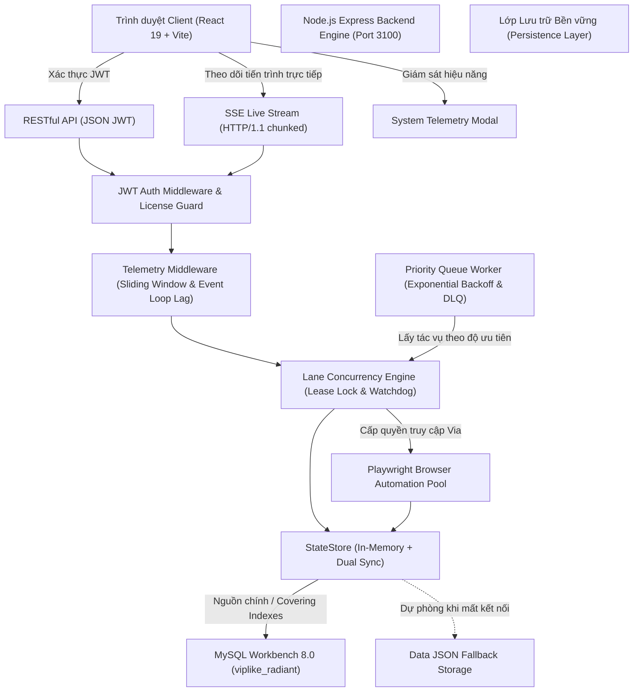
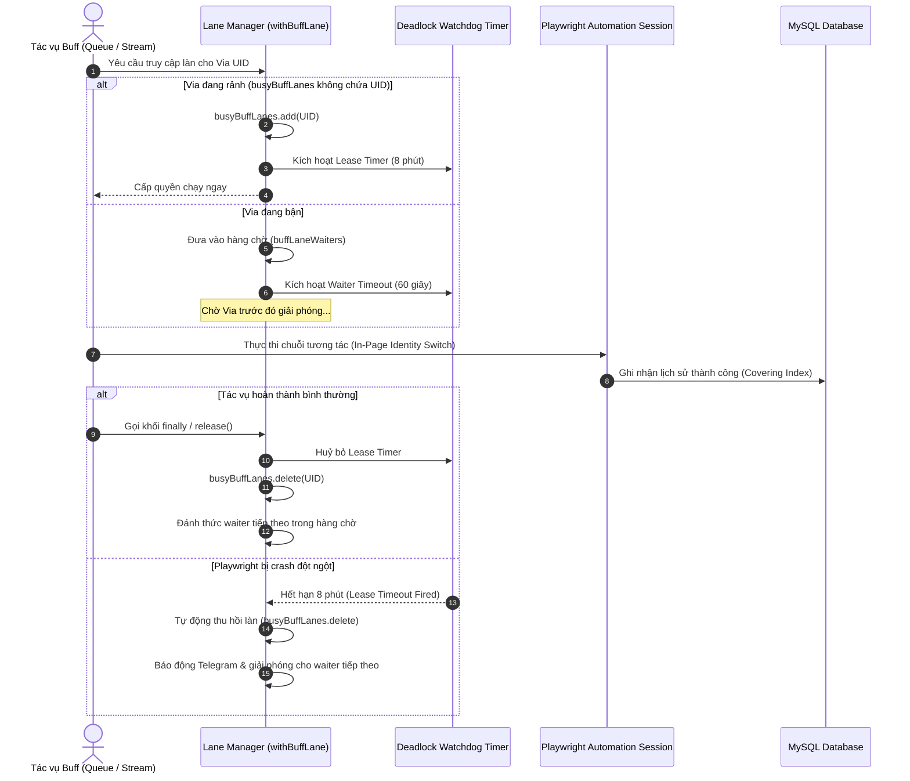
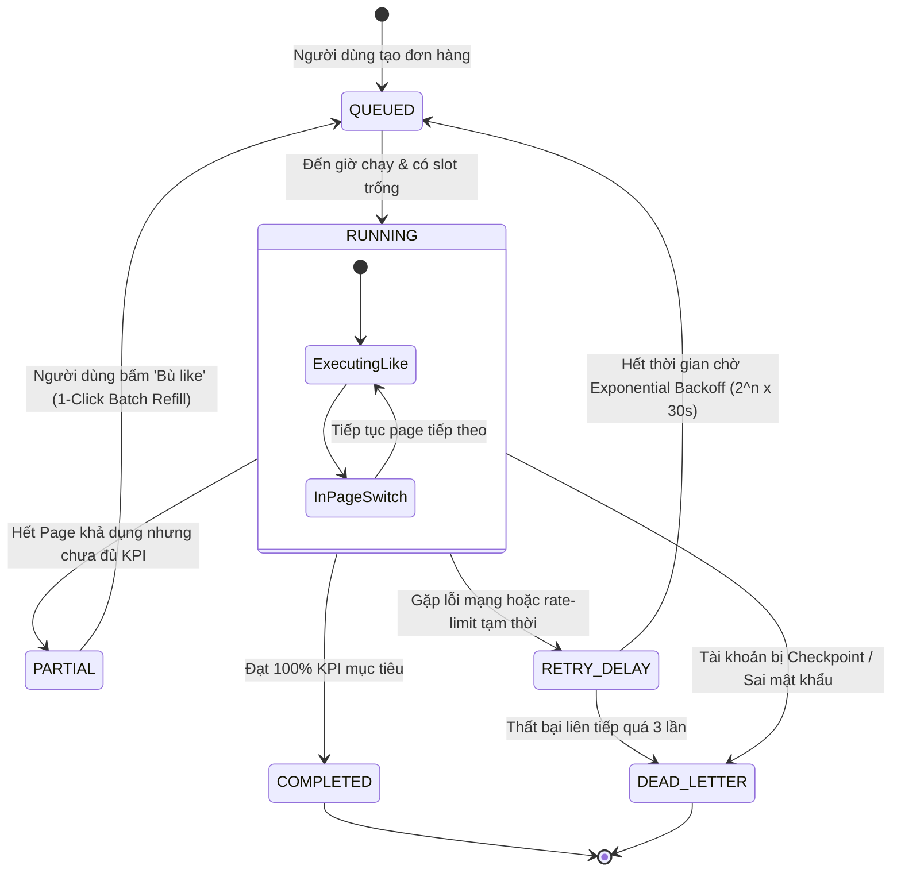

# KIẾN TRÚC HỆ THỐNG BUFF LIKE 3.0 ENTERPRISE (ARCHITECTURE V3)
## DỰ ÁN: VIPLIKE RADIANT

---

### 1. SƠ ĐỒ TỔNG THỂ KIẾN TRÚC HỆ THỐNG (SYSTEM OVERVIEW)

---

### 2. CƠ CHẾ KHOÁ LÀN ĐỒNG THỜI & CHỐNG BẾ TẮC (CONCURRENCY & LEASE LOCKING)

Mỗi Via Facebook chỉ được phép phục vụ một tác vụ tương tác tại một thời điểm để đảm bảo an toàn tài khoản và tránh bị nền tảng phát hiện hành vi bất thường.

---

### 3. MÁY TRẠNG THÁI TÁC VỤ HÀNG ĐỢI & XỬ LÝ LỖI (QUEUE & FAULT-TOLERANCE STATE MACHINE)

---

### 4. ĐỘC LẬP TÀI NGUYÊN & GIÁM SÁT THỜI GIAN THỰC (TELEMETRY ENGINE)

TelemetryEngine hoạt động độc lập bên trong tiến trình Node.js:
- **Event Loop Monitor**: Sử dụng `perf_hooks.monitorEventLoopDelay({ resolution: 20 })` để theo dõi độ trễ của microtask queue ở cấp độ nano-giây.
- **Sliding Window**: Duy trì cửa sổ trượt 1,000 mẫu gần nhất để tính toán các chỉ số phân vị P50, P95, P99 mà không làm tăng tải RAM.
- **Health & Readiness Probes**: Cung cấp các điểm cuối chuẩn hoá `/api/health` và `/api/readiness` phục vụ kiểm tra sức khoẻ tự động trong các môi trường triển khai container hoá.
