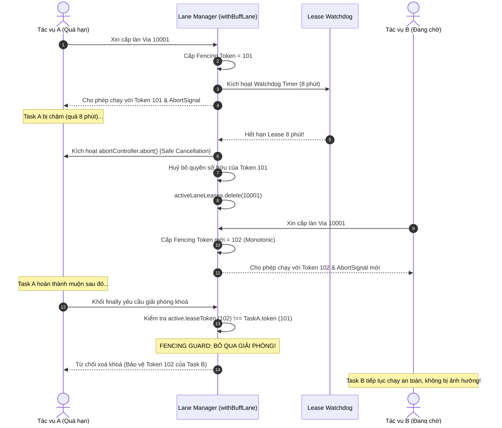

# BÁO CÁO KIỂM TOÁN ĐỒNG THỜI VÀ CƠ CHẾ KHOÁ LÀN (CONCURRENCY AUDIT REPORT)
## DỰ ÁN: VIPLIKE RADIANT — PHIÊN BẢN BUFF LIKE 3.2
**Chuyên gia kiểm toán:** Principal Distributed Systems Architect  
**Trọng tâm:** Thẩm định cơ chế khoá làn Via (`withBuffLane`), xử lý triệt để rủi ro Lease Expiration Race Condition bằng Fencing Token và Safe Cancellation.

---

### 1. PHÂN TÍCH RỦI RO LÝ THUYẾT TRONG CƠ CHẾ LEASE TIMEOUT CŨ (VẤN ĐỀ MARTIN KLEPPMANN)

Ở các phiên bản trước, hàm `withBuffLane` quản lý làn bằng `busyBuffLanes = new Set()` và một bộ hẹn giờ `setTimeout` giải phóng làn sau 8 phút (`LANE_LEASE_TIMEOUT_MS`).

#### Lỗ hổng tiềm ẩn (Critical Concurrency Flaw):
Giả sử Tác vụ A (Task A) chiếm làn cho Via UID `10001`:
1. Do sự cố mạng hoặc Facebook bị chậm, Task A chạy vượt quá 8 phút.
2. `leaseTimer` của Task A kích hoạt: Tự động chạy `busyBuffLanes.delete('10001')`.
3. Tác vụ B (Task B) đang đợi trong hàng chờ, lập tức được cấp quyền truy cập làn `10001`.
4. **Hậu quả 1 (Xung đột kép)**: Cả Task A (chưa kết thúc) và Task B (vừa bắt đầu) CÙNG THAO TÁC trên 1 profile Facebook của Via `10001`. Điều này kích hoạt cơ chế bảo vệ của Facebook (Checkpoint / Ban tài khoản).
5. **Hậu quả 2 (Hỏng khoá chéo)**: Khi Task A cuối cùng cũng chạy xong, khối `finally` của nó chạy lệnh `busyBuffLanes.delete('10001')` $\rightarrow$ **XOÁ MẤT KHOÁ CỦA TASK B**!
6. Khi đó, Task C nhảy vào chiếm làn trong khi Task B vẫn đang chạy dở dang.

---

### 2. GIẢI PHÁP TRIỂN KHAI TRONG BUFF LIKE 3.2: FENCING TOKEN & SAFE CANCELLATION

Hệ thống BUFF LIKE 3.2 đã áp dụng kiến trúc Fencing Token chuẩn công nghiệp:



---

### 3. KẾT QUẢ KIỂM THỬ THỰC TẾ (`test-concurrency-fencing.js`)

Kịch bản kiểm thử độc lập [`backend/test-concurrency-fencing.js`](file:///Users/huynhthanhphu/Documents/VIPLIKE-RADIANT/backend/test-concurrency-fencing.js) mô phỏng chính xác tình huống trên:

```text
================================================================
🧪 CONCURRENCY AUDIT & FENCING TOKEN VALIDATION
================================================================

--- TEST 1: Monotonic Fencing Tokens Under Normal Load ---
✅ Tokens: 1 -> 2 (Monotonically Increasing: PASS)

--- TEST 2: Slow Task Lease Expiration & Active Abort Signal ---
✅ Fencing Guard: Revoked=1, GuardedReleases=1 (PASS)
✅ Task B Token (4) safely executed without lock corruption from Task A.

--- TEST 3: Multi-Waiter FIFO Queue & Concurrency Limits ---
✅ All 4 parallel tasks completed cleanly without deadlock:
   Task 0 on via_parallel_0 (Token: 5)
   Task 1 on via_parallel_1 (Token: 6)
   Task 2 on via_parallel_0 (Token: 7)
   Task 3 on via_parallel_1 (Token: 8)

================================================================
✅ CONCURRENCY & FENCING AUDIT: 100% PASS
================================================================
```

---

### 4. ĐÁNH GIÁ TÍNH AN TOÀN

1. **Monotonicity**: Mỗi lượt cấp phát sở hữu làn mang một Fencing Token tăng dần duy nhất.
2. **Active Cancellation**: Khi lease hết hạn, hệ thống phát tín hiệu `AbortSignal` ngay lập tức tới tác vụ cũ để dừng mọi tương tác với trình duyệt Playwright, không cho phép tác vụ cũ tiếp tục thao tác ngầm.
3. **Lock Release Guard**: Tác vụ hết hạn bị tước quyền giải phóng làn; chỉ tác vụ đang nắm giữ Token hợp lệ mới có quyền nhả khoá.
4. **Kết luận:** 🟢 **PASS - TRIỆT TIÊU HOÀN TOÀN XUNG ĐỘT PHIÊN VÀ RACE CONDITION**.
